<div align="center">

<!-- 01 HERO SECTION -->
<a href="https://syed.snapz.dev/">
  
</a>

<br/>

<!-- 02 ABOUT & CAPABILITIES -->


<br/>

<!-- 03 TECHNICAL ORBITS & STACK -->


<br/>

<!-- 04 DEV ID & METRICS -->


<br/>

<!-- 05 CONNECT & CHANNELS -->


<br/>

<!-- CLICKABLE LINKS (GitHub SVGs cannot embed external web links) -->
<p align="center">
  <a href="https://syed.snapz.dev/">
    
  </a>
  <a href="https://snapz.dev/">
    
  </a>
  <a href="https://discord.gg/Snapz">
    
  </a>
  <a href="https://www.instagram.com/syed_exe">
    
  </a>
  <a href="mailto:Support@snapz.dev">
    
  </a>
</p>

</div>

<br/>

---

### 🚀 LIVE PROJECTS & SYSTEMS

<table>
  <!-- PROJECT 01: SNAPZCLOUD -->
  <tr>
    <td width="48%" valign="middle" align="center" style="background:#070b16; border:1px solid rgba(255,53,79,0.4); border-radius:12px; padding:18px;">
      <a href="https://snapz.dev/">
        
      </a>
      <br/><br/>
      <a href="https://snapz.dev/">
        
      </a>
      <a href="https://github.com/Syed-exe">
        
      </a>
    </td>
    <td width="52%" valign="top" style="background:#070b16; border:1px solid rgba(255,53,79,0.4); border-radius:12px; padding:18px;">
      <h3>#01 · SnapZCloud  </h3>
      <p><b>Domain:</b> Cloud Hosting • Infrastructure • Scalability</p>
      <p><i>High-performance hosting infrastructure with infinite scalability — power your apps instantly.</i></p>
      <ul>
        <li><b>Cloud Servers &amp; VPS:</b> Fast, reliable compute for apps, sites and services.</li>
        <li><b>Dedicated Hosting:</b> Full-power machines for demanding workloads.</li>
        <li><b>Minecraft &amp; Bot Hosting:</b> One-stop hosting for game servers and Discord bots.</li>
      </ul>
      <p>
           
      </p>
      <p><b>Telemetry:</b> <code>Infinite Scalability</code> | <code>Cloud + VPS</code> | <code>Bot &amp; Game Hosting</code></p>
    </td>
  </tr>

  <!-- PROJECT 02: ITACHI UNIVERSE -->
  <tr>
    <td width="48%" valign="middle" align="center" style="background:#070b16; border:1px solid rgba(36,123,255,0.4); border-radius:12px; padding:18px;">
      <a href="https://itachi.snapz.dev/">
        
      </a>
      <br/><br/>
      <a href="https://itachi.snapz.dev/">
        
      </a>
      <a href="https://github.com/Syed-exe">
        
      </a>
    </td>
    <td width="52%" valign="top" style="background:#070b16; border:1px solid rgba(36,123,255,0.4); border-radius:12px; padding:18px;">
      <h3>#02 · Itachi Universe  </h3>
      <p><b>Domain:</b> Creative Web • Anime Tribute • Scroll Storytelling</p>
      <p><i>Animated tribute to Itachi Uchiha — the prodigy, the Akatsuki member, the shinobi who carried his village's darkest secret.</i></p>
      <ul>
        <li><b>Scroll-Driven Story:</b> Moonlit art direction with cinematic, animated sections.</li>
        <li><b>Full Archive:</b> About, Biography, Clan, Strength, Jutsu, Legacy &amp; Quotes pages.</li>
        <li><b>Premium UI:</b> Custom portrait art, smooth motion and responsive layout.</li>
      </ul>
      <p>
          
      </p>
      <p><b>Telemetry:</b> <code>8 Pages</code> | <code>Scroll Animations</code> | <code>Cinematic UI</code></p>
    </td>
  </tr>

  <!-- PROJECT 03: SHIDDAT -->
  <tr>
    <td width="48%" valign="middle" align="center" style="background:#070b16; border:1px solid rgba(255,53,79,0.4); border-radius:12px; padding:18px;">
      <a href="https://shiddat.snapz.dev/">
        
      </a>
      <br/><br/>
      <a href="https://shiddat.snapz.dev/">
        
      </a>
      <a href="https://github.com/Syed-exe">
        
      </a>
    </td>
    <td width="52%" valign="top" style="background:#070b16; border:1px solid rgba(255,53,79,0.4); border-radius:12px; padding:18px;">
      <h3>#03 · Shiddat  </h3>
      <p><b>Domain:</b> Music Streaming • Web + Desktop + Android</p>
      <p><i>A modern music streaming platform to discover, listen to and enjoy music across all your devices.</i></p>
      <ul>
        <li><b>Rich Library:</b> Liked songs, albums, history, custom playlists and music insights.</li>
        <li><b>Social Listening:</b> Shiddat Blend and Friends Live — add friends by Blend Tag.</li>
        <li><b>Everywhere:</b> Web player plus installable Mac, Windows &amp; APK apps with synced lyrics.</li>
      </ul>
      <p>
           
      </p>
      <p><b>Telemetry:</b> <code>Hindi • Telugu • English</code> | <code>Synced Lyrics</code> | <code>Web + APK + Desktop</code></p>
    </td>
  </tr>

  <!-- PROJECT 04: NITRA -->
  <tr>
    <td width="48%" valign="middle" align="center" style="background:#070b16; border:1px solid rgba(36,123,255,0.4); border-radius:12px; padding:18px;">
      <a href="https://nitra.snapz.dev/">
        
      </a>
      <br/><br/>
      <a href="https://nitra.snapz.dev/">
        
      </a>
      <a href="https://github.com/Syed-exe">
        
      </a>
    </td>
    <td width="52%" valign="top" style="background:#070b16; border:1px solid rgba(36,123,255,0.4); border-radius:12px; padding:18px;">
      <h3>#04 · Nitra  </h3>
      <p><b>Domain:</b> Web Project • SnapZ Network</p>
      <p><i>Live project deployed on the SnapZ platform.</i></p>
      <ul>
        <li><b>Live Deployment:</b> Running in production at nitra.snapz.dev.</li>
        <li><b>SnapZ Ecosystem:</b> Part of the SnapZ project network alongside Shiddat and Itachi.</li>
        <li><b>Actively Built:</b> Shipped clean, fast and ready to scale.</li>
      </ul>
      <p>
          
      </p>
      <p><b>Telemetry:</b> <code>Live</code> | <code>Production</code> | <code>SnapZ Network</code></p>
    </td>
  </tr>

  <!-- PROJECT 05: SYED_EXE PORTFOLIO -->
  <tr>
    <td width="48%" valign="middle" align="center" style="background:#070b16; border:1px solid rgba(255,53,79,0.4); border-radius:12px; padding:18px;">
      <a href="https://syed.snapz.dev/">
        
      </a>
      <br/><br/>
      <a href="https://syed.snapz.dev/">
        
      </a>
      <a href="https://github.com/Syed-exe">
        
      </a>
    </td>
    <td width="52%" valign="top" style="background:#070b16; border:1px solid rgba(255,53,79,0.4); border-radius:12px; padding:18px;">
      <h3>#05 · Syed_exe Portfolio  </h3>
      <p><b>Domain:</b> Developer &amp; Designer • Services • Case Studies</p>
      <p><i>Professional developer &amp; designer portfolio — websites, apps, bots, automation and AI integrations, from idea to deployment.</i></p>
      <ul>
        <li><b>Services:</b> Web development, backend &amp; APIs, app development, bots &amp; automation.</li>
        <li><b>Case Studies &amp; Blog:</b> Featured builds plus writing on performance, conversion and bot scaling.</li>
        <li><b>Hire Me:</b> Open for freelance — discovery, design, build and launch workflow.</li>
      </ul>
      <p>
           
      </p>
      <p><b>Telemetry:</b> <code>Freelance Ready</code> | <code>Full-Stack</code> | <code>24/7 Support</code></p>
    </td>
  </tr>

</table>

<br/>

---

### 🐍 LIVE TELEMETRY & CONTRIBUTION SNAKE GAME

<div align="center">

<p align="center">
  <b>🎮 365-Day Contribution Snake (auto-updates every 12 hours)</b>
</p>

<!-- SNAKE ANIMATION SVG (generated by .github/workflows/snake.yml) -->


<br/><br/>

<p align="center">
  <b>📈 Contribution Activity Graph</b>
</p>


<br/><br/>

<table border="0" width="100%">
  <tr>
    <td align="center" valign="middle" width="50%" style="background:#070b16; border:1px solid rgba(255,53,79,0.35); border-radius:12px; padding:12px;">
      
    </td>
    <td align="center" valign="middle" width="50%" style="background:#070b16; border:1px solid rgba(36,123,255,0.35); border-radius:12px; padding:12px;">
      
    </td>
  </tr>
  <tr>
    <td colspan="2" align="center" valign="middle" style="background:#070b16; border:1px solid rgba(255,53,79,0.35); border-radius:12px; padding:12px;">
      
    </td>
  </tr>
</table>

</div>

<br/>

---

### 🍿 POST-CREDITS

<div align="center">

<h3><i>"Build Smart. Scale Fast. Stay Elegant."</i></h3>

<p>
  <a href="https://syed.snapz.dev/">
    
  </a>
  <a href="https://syed.snapz.dev/contact">
    
  </a>
  <a href="https://discord.gg/snap-z-1102558646505836606">
    
  </a>
  <a href="mailto:snipeop69@gmail.com">
    
  </a>
</p>

<br/>

```
╔════════════════════════════════════════════════════════════════════════════╗
║                 TO BE CONTINUED... NEXT BUILD LOADING                      ║
║        Current Production: SnapZCloud • Shiddat • Nitra • Itachi           ║
╚════════════════════════════════════════════════════════════════════════════╝
```

<br/>

<a href="#top"><b>▲ RETURN TO TOP</b></a>

</div>
